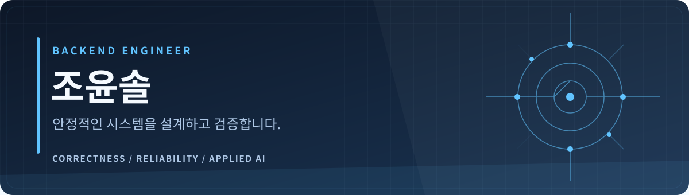

  

<h2 align="center">안녕하세요, 백엔드 개발자 조윤솔입니다.</h2>

  Java와 Spring Boot를 기반으로 <b>비즈니스 규칙과 데이터 정합성</b>을 지키는 서버를 만듭니다. 
  결제·기업용 시스템 개발 경험을 바탕으로, 최근에는 <b>검증 가능한 AI 응용 시스템</b>을 개발하고 있습니다.

  
  
  

---

### 👋 About Me

**결제 상태부터 AI 응답까지, 무엇을 신뢰할 수 있는지 명확히 정의하는 개발을 지향합니다.**

백엔드를 단순한 요청 처리 계층이 아닌, 중요한 비즈니스 상태를 안전하게 보존하는 시스템으로 바라봅니다. 문제 재현과 원인 분석, 설계 결정, 구현, 회귀 검증으로 이어지는 근거를 남기려 노력합니다.

- **Focus** — 데이터 정합성, 권한 경계, 외부 장애 격리, 멱등성과 동시성
- **Engineering** — 실패 조건을 먼저 정의하고, 선택한 설계의 보장 범위와 한계를 명확히 설명
- **Learning & Growth** — 분산 시스템의 신뢰성, AI 평가, 개발 도구의 실행 안전성

<h3 align="center">🛠️ My Skill Set</h3>

<table align="center" width="100%">
  <tr>
    <th align="center">Backend &amp; Data</th>
    <th align="center">Applied AI &amp; Infrastructure</th>
  </tr>
  <tr>
    <td width="50%" align="center" valign="top">
       
      
       
      
       
      
       
      
        
    </td>
    <td width="50%" align="center" valign="top">
       
      
       
      
       
      
       
      
        
    </td>
  </tr>
</table>

### 📂 Featured Projects

| 공개 프로젝트 | 기술적 문제와 접근 |
| :--- | :--- |
| **[Agent Diary](https://github.com/solzip/agent-diary)** Python · CLI · Concurrency | Claude Code·Codex 작업 기록을 보존하는 도구입니다. 멀티프로세스에서 발생한 기록 유실을 재현하고 파일 잠금, 원자적 교체, 부분 실패 복구 및 독립 프로세스 회귀 테스트로 대응했습니다. [아키텍처](https://github.com/solzip/agent-diary/blob/main/docs/ARCHITECTURE.md) |
| **[CodeFleet](https://github.com/solzip/CodeFleet)** Node.js · AI Orchestration | AI의 완료 주장과 실제 실행 증거를 분리합니다. 작업 계약, 변경 범위, 승인 경계와 검증·복구 흐름을 구현하며 검증된 범위와 미완료 기능을 문서로 구분합니다. [기술 문서](https://github.com/solzip/CodeFleet/blob/main/docs/product-completion/architecture.md) |

### 🏢 실무에서 다룬 문제들

> 업무 코드와 고객 데이터는 비공개로 유지합니다. 아래는 기술적 판단을 설명할 수 있는 범위의 요약입니다.

| 영역 · 단계 | 설계와 검증에서 집중한 문제 |
| :--- | :--- |
| **결제 게이트웨이 · 실운영** | 외부 본사 API 장애가 내부 결제 확정 상태를 훼손하지 않도록 결제 상태와 송신 결과를 분리하고, 타임아웃 및 감사 기록으로 실패를 추적했습니다. |
| **기업용 AI 상담 · 사내 STG 파일럿** | Java/Spring 기반 RAG·업무 조회 API, 매장 소속 권한 검증, 근거 없는 오류코드 답변 차단, 평가 및 배포 확인 절차를 구현했습니다. |
| **사내 기부 키오스크 · 파일럿** | 외부 HR 정보 연동에서 개인정보 저장을 최소화하고, 동시 기부 집계의 트랜잭션·잠금 문제를 개선했습니다. |
| **결제·예약 MSA · 미출시** | 결제 → 발급 → 예약의 순서를 불변식으로 다루고, 거래 식별자와 보상·롤백 경로를 설계했습니다. 출시 성과로 표현하지 않습니다. |
| **ERP MSA 재설계 · 설계 채택** | Django 레거시의 도메인 경계를 분석하고 19개 서비스 단위의 구조를 제안했습니다. 설계 채택과 실제 운영 전환은 구분합니다. |

---

  <b>명확한 계약 · 장애 격리 · 검증 가능한 결과</b> 
  Define the contract. Isolate failures. Verify the result.

